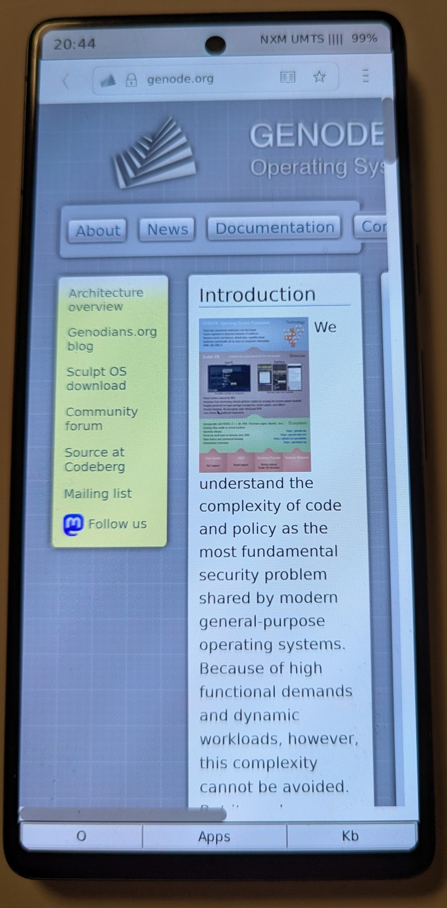

# Why the Google Pixel 7

## Why this phone

At the time of the decision, the Pixel 7 offered a combination that is rare
among current phones:

- **Open-source Linux kernel and drivers.** Google published the kernel
  sources and the drivers of the device. They are the reference for how the
  hardware works, and several of the drivers here are ports of them.

- **Unlockable boot loader.** The boot loader can be unlocked with the
  standard tools and then starts a self-built image, either flashed or
  directly from RAM via fastboot. No exploit is needed.

- **Access to the UART.** The serial console of the SoC is reachable through
  the USB-C connector and can be switched on from the boot loader. Bringing
  up a kernel without a serial console is guesswork, with it, the first
  character printed by the boot code is visible.

- **The kernel is started at EL2.** The boot loader hands over control at
  the hypervisor exception level of the CPU. A custom kernel can therefore
  use the hardware virtualization extensions, which Genode's kernel supports:
  virtual machines can run next to native Genode components.

The other half of the answer is timing. With an LLM, I finally had an
assistant that could help me with a project of this size, so that I can focus
on the design of the operating system instead of the manual work.

*Genode running on a Google Pixel 7: the web browser has loaded genode.org
over the mobile network.*

## Status

A prototype is ready. Display, touch, audio, and the modem are minimally
working. The code is being cleaned up and will be published here step by
step. Stay tuned.

The preparation of a device is described in
[device_preparation.md](device_preparation.md).
